# Rotary knob user manual

> DRAFT 3, 2026-11-25, written from the implemented behaviour. Items marked **(not verified)** have not been tried on the real
> hardware yet. The autopilot, anchor and motor sections get their final words after the trials at the boat.
>
> Apart from the photo, the pictures are renderings: the screens of the version after v0.2.0 (585ea07) drawn on a PC, with simulated data (`tools/ui-render`). Most are from demo mode,
> hence the `DEMO` at the bottom edge.

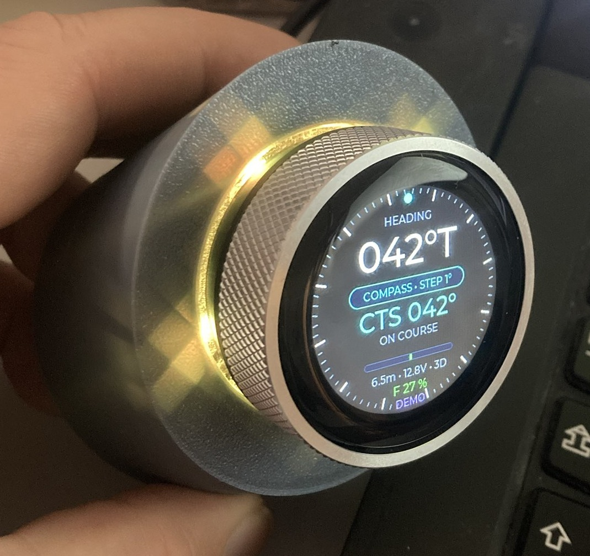

*The knob in demo mode (photo).*

The knob is a helm-side control surface for a SignalK boat: it steers the autopilot, watches the anchor, switches lights, turns
the music up and down, and can drive a motor's throttle. It has one round screen, an endless dial with a push button, five LEDs
around the base, and a touch screen that is only a helper.

## 1. First setup

1. **Power.** Connect 5 V (1 A) to the knob. It starts by itself and is meant to stay on.
2. **Wi-Fi.** On the first start the knob shows `JOIN WI-FI` and opens its own network, named `espOS-` followed by four characters. Join it
   from a phone and open the setup page (`http://192.168.4.1`), choose your network and enter the password. The setup network is
   open, so do this at home or on the boat and not in a crowded marina.
3. **Pairing.** The knob finds the SignalK server on its own, or you give the server address on the settings page. It then shows
   `PAIRING, WAITING FOR APPROVAL`. In the SignalK admin UI open Security, Access Requests, find the request named after the knob and
   approve it with **read/write** permission. This is done once.
4. **Online.** The splash picture shows the phases (`WI-FI`, `SIGNALK`, `TOKEN`) with a progress bar. When the knob is accepted by
   the server it opens the screen you used last, says `CONNECTING` for a moment until the data is there, and the controls work.
   A normal start takes about six seconds.

5. **Two settings worth making once** (settings page, `http://<knob name>.local`):
   - *Time*, *Fall back to the SignalK clock*: switch it off. With it on, the knob loses its connection a few seconds after every
     start (a SignalK server limit), it does not need the clock.
   - *HTTP server*, *API key*: optional. Without one the page is open to everyone on the boat network, which is fine on a boat's
     own Wi-Fi. If you set one, the page asks for it.

If the knob is moved to a different network, or its approval is removed on the server, it goes through the steps again. To start
over completely use *Reset setup* in the knob's settings (hold 5 seconds): it forgets the Wi-Fi and the approval and opens the
setup network again.

| 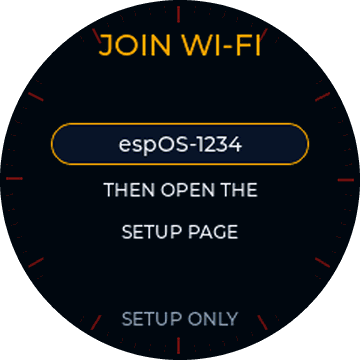 | 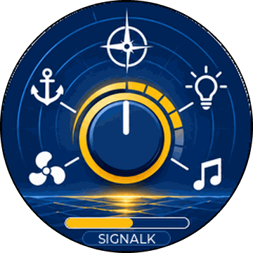 | 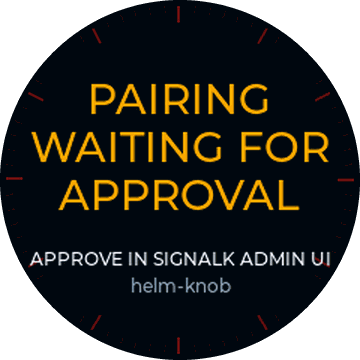 | 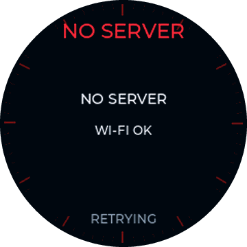 |
|:---:|:---:|:---:|:---:|
| Join the setup network | Starting | Approve the knob in the SignalK admin UI | The server cannot be reached |

## 2. Using the knob

| Input | What it does |
|---|---|
| Turn | Changes the value on the screen (target heading, lights, anchor radius, volume, throttle) |
| Single press | Confirms, or steps to the next item (next light channel) |
| Double press | Opens the mode ring: turn to pick a mode, press to switch |
| Long press (about 0.75 s) | State changes: engage the autopilot, switch a light on or off |
| Touch | Secondary and never changes autopilot or anchor state. A touch in the centre is ignored (a push on the knob presses the glass there) |

Safety rules: the autopilot is engaged with a long press **and** a confirm turn. A bumped dial cannot engage anything, and losing
the knob (unplugged, Wi-Fi gone) never changes the autopilot or the anchor. A motor is the exception: it goes to neutral (see
Motor).

### The mode ring
A double press opens it. Turn to a mode, press to switch. Another double press closes it. Clockwise the order is `MOTOR`, `AUTO`
(at 12 o'clock), `ANCHOR`, `LIGHTS`, `MUSIC`, `GAUGE`, `USB`, `SETUP`. A mode that is switched off is left out and the others keep their
order. `USB` only shows while a computer is connected, and `SETUP` is hidden during an alarm.

**Choosing the modes.** Open the settings on the knob and choose *MODES*: one pill per mode. A filled pill is on the ring. Turn to
a pill and press to switch it, press twice to go back. One mode always stays on. The same switches are on the settings page
(*AUTOPILOT mode*, *LIGHTS mode* and so on). `MOTOR` is off on a new knob. **(not verified)**

| 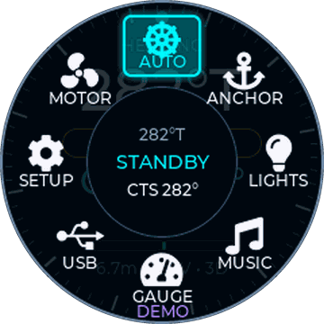 | 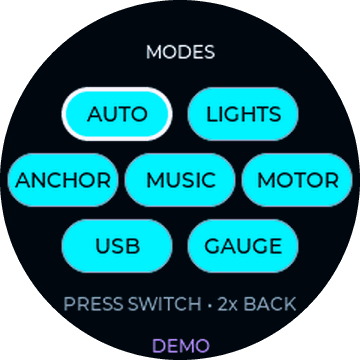 |
|:---:|:---:|
| The mode ring | The *MODES* page |

## 3. Modes

### Autopilot
The screen shows the heading in large digits with its reference (`T` true or `M` magnetic, chosen in the settings), a ring of heading
ticks, and the course to steer (`CTS`).
- **Engage:** a long press opens the confirm prompt, then turn right within 5 seconds to confirm. Engage is always compass
  steering, whatever the pilot did last.
- **Change the target (compass, while engaged):** turn. A pause of about 0.4 s sends it. A single press switches the step between
  1 and 10 degrees.
- **Pilot dialog (while engaged):** a long press opens it with `STANDBY` highlighted, so a long press and one press is standby.
  Turn to choose `COMPASS`, `WIND` or `ROUTE`, or `TACK PORT` and `TACK STARBOARD` (in compass and wind), and press. A tack then
  asks for one click towards the tack side within 5 seconds. Even when the pilot's data is missing the dialog opens, with
  `STANDBY` only.
- **Wind:** the apparent wind angle large with `P` or `S`, the pilot's target in amber, a cyan line for the wind. The wind
  target is set on the pilot itself for now (`ADJUST ON PILOT`).
- **Route:** the distance off the track large, `STEER LEFT` or `STEER RIGHT` with a bar, bearing and distance to the next
  waypoint. Turning does nothing.
- The LEDs show the steering error while this screen is open: **red** means turn to port, **green** to starboard, **yellow** on course
  while engaged, **blue** on course in standby. On course means within 2 degrees (it stays on course until the error passes 3).
  At night the on-course colour fades out after 2 seconds, red and green stay.
- No rudder angle or depth is shown unless your boat publishes them (the display shows `---`).

| 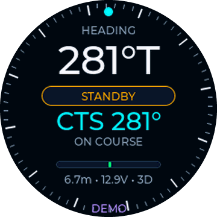 | 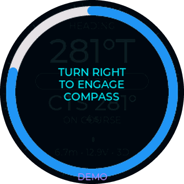 | 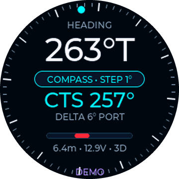 | 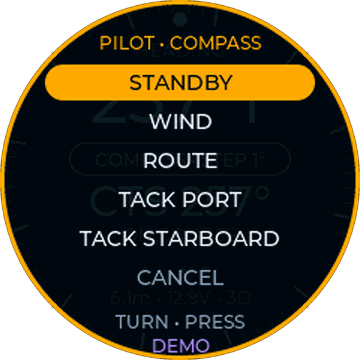 |
|:---:|:---:|:---:|:---:|
| Standby | Engage: the confirm turn | Steering to the target | The pilot dialog |

| 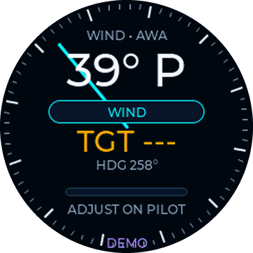 | 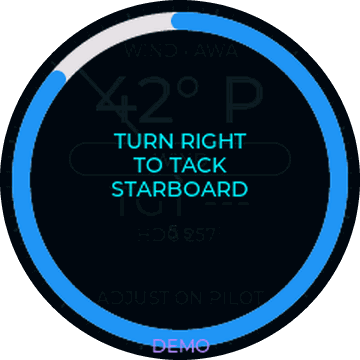 | 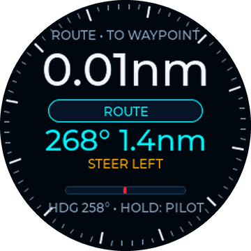 |
|:---:|:---:|:---:|
| Wind (no target from the pilot here) | Tack: the confirm turn | Route |

### Lights
Channels are set on the settings page (name, SignalK path, relay or dimmer). The boat this was built for has relays only, so a channel
is on or off:
- **Turn right** switches the channel on, **turn left** off. One click is enough.
- **Single press** picks the next channel, **long press** toggles the selected one.
- A dimmer channel shows a level arc and changes in 5 % steps. A switched-off dimmer keeps its level: the first click only turns it
  back on at that level.
- The LEDs around the base light warm white while the selected channel is on: all five for a switched channel, a level for a
  dimmer (filling clockwise from the bottom left, the bottom LED on). They stay dark at night. **(not verified)**

| 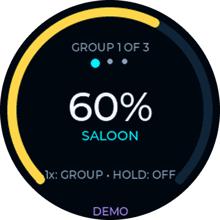 | 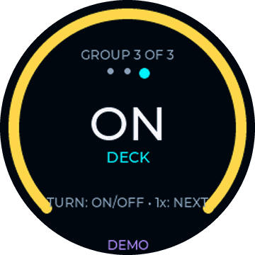 |
|:---:|:---:|
| A dimmer channel | A relay |

### Anchor
The watch circle is drawn as a plot: the ring is the radius you chose, the green dot is the boat, the anchor is in the centre, and
a short trail shows where the boat has been. The distance is written next to the dot. The top line says `DROPPED` or `RAISED`.
With the **hoekens-anchor-alarm** plugin installed:
- **Turn** changes the radius (a new amber ring shows the preview), a **press** applies it.
- **Long press** opens a dialog with only the actions that fit: **Drop here** while the anchor is raised, **Move drop point here**
  and **Raise anchor** while it is dropped, and always **Cancel**. While it is dropped, **Raise anchor** is the one selected
  when the dialog opens. Turn to choose, press to confirm. A radius you turned to but
  did not apply is used when you drop.
- After you choose, the screen shows a spinner until the server confirms. If the knob could not do it, it says why (control is
  off, no link, no position fix, the server refused, not confirmed) and that nothing was changed.
Anchor and autopilot commands are only sent when **allow control** is on (see section 6).

| 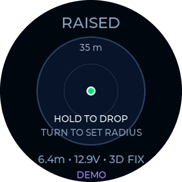 | 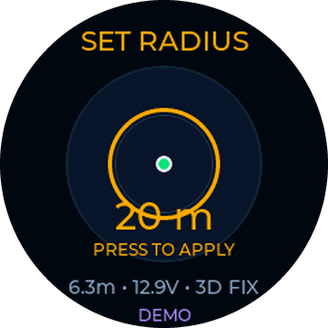 | 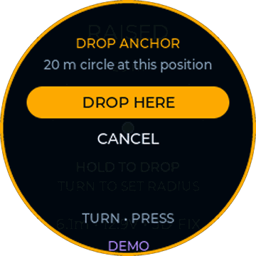 | 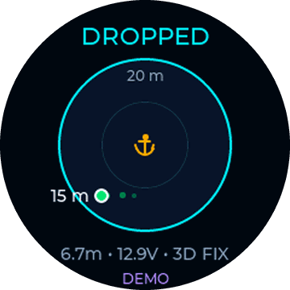 |
|:---:|:---:|:---:|:---:|
| Anchor raised | Turn: the new radius | Hold: drop here | The watch, with the trail |

| 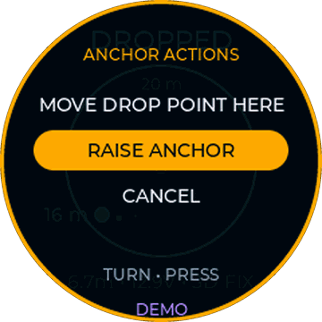 | 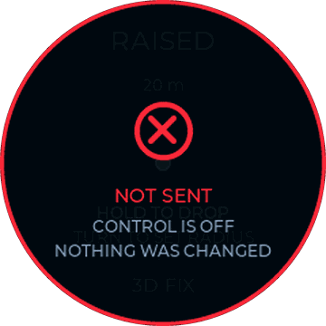 |
|:---:|:---:|
| Hold while dropped | Refused: allow control is off |

### Music

The boat's music through the jukebox on the SignalK server. Turn for the volume (2 % a click, sent when you stop turning), press
to play or pause, hold to step from `MASTER` to each zone. The touch screen is a small player: previous on the left, next on
the right, play or pause at the bottom, tap the name at the top for the next zone.
The line under the volume says `PAUSED` while paused. A zone whose speaker is off shows `ZONE OFFLINE`. On a boat without the
jukebox, switch the mode off (see *Choosing the modes*).

The LEDs around the base show the volume in violet-blue, filling clockwise from the bottom left (half volume lights the left
two), dimmer for a muted zone. The bottom LED is green while the music plays. They stay dark at night. **(not verified)**

| 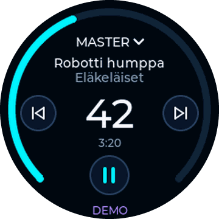 |
|:---:|
| Volume and player |

### Motor
**(not verified, no motor has been driven by the knob yet)** For a motor whose controller takes a throttle over SignalK. Off
by default: switch *MOTOR mode* on in the settings page, and set *Motor id* (the `<id>` in `propulsion.<id>`) and, if you
have one, *Motor power path*. The mode then sits just left of AUTO on the ring. Throttle commands need **allow control** (section 6).

- **Arm:** with the motor in neutral, hold the knob, then turn one click right within 5 seconds. The knob never takes over a
  running motor: out of neutral it says `SET NEUTRAL FIRST`.
- **Throttle:** turn right for more ahead, left for more astern. Slow clicks are 1 %, faster turning takes bigger steps (the
  *Throttle steps* setting: gentle, normal or quick). Neutral is at 12 o'clock, ahead in green clockwise, astern in amber.
- **Through neutral:** a turn from ahead towards neutral ends at neutral, however fast and far you spin. Let go for a moment (a
  quarter of a second is enough) and turn on into astern, and the same the other way. Holding the knob also goes to neutral.
- **Neutral:** hold the knob. Hold it again in neutral to disarm. A single press does nothing.
- **Limits:** the throttle stops at 50 % each way (*Throttle limit ahead / astern* on the settings page, `MOTOR LIMITS` in
  the knob's settings) and warns. Turning back below the limit clears the warning. A double press while it shows allows
  more until the knob is disarmed.
- **The knob lets go by itself**, sending neutral first, when allow control is switched off, the link drops, the motor stops
  reporting its gear for 3 seconds, the gear reports a fault or does not follow the throttle, or after a minute in neutral
  without input (*Motor disarm when idle*, 0 = never; on the knob `MOTOR DISARM` under `MOTOR LIMITS`). Arm again to go on.
- While the motor runs, the knob repeats the throttle every second. The motor's controller has to go to neutral by itself
  when it hears nothing for about 3 seconds, so a knob that dies or loses Wi-Fi leaves the motor in neutral.
- While the motor is out of neutral, every other screen shows `F 40 %` or `R 15 %` at the bottom and the screen stays on.

| 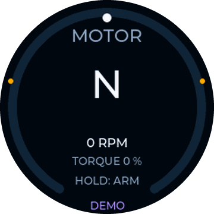 | 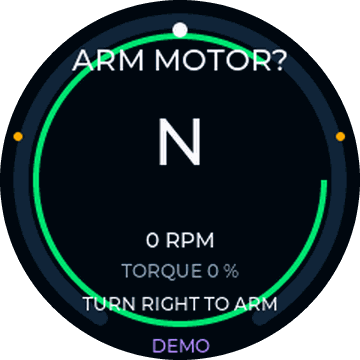 | 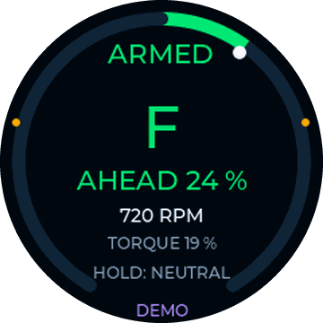 | 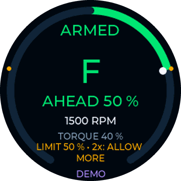 |
|:---:|:---:|:---:|:---:|
| Disarmed | Arm: the confirm turn | Ahead | At the limit |

| 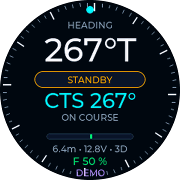 |
|:---:|
| The throttle on another screen |

### Gauges
**(not verified on the hardware yet)** Up to four values from SignalK as gauges, one per page. Turn to step through them. The
knob only reads: nothing is sent, allow control does not matter.

Set the pages on the settings page: *Gauge 1 path* to *Gauge 4 path*, any SignalK path with a number. On a new knob they are
depth, speed over ground, apparent wind speed and the house battery's voltage. An empty path removes the page. *Gauge N name*
replaces the name shown. Changes apply after a restart.

The knob takes everything else from the server: the unit, the range of the arc (*displayScale*) and the **zones**. Set the
zones of a path once on the server (in the SignalK admin UI under *Server, Data Browser*, the path's meta) and the knob colours
its gauge the same way as any other display: a thin band around the arc shows the zones, green for normal, amber for a warning,
red for an alarm. When the value is in a warning or alarm zone, the number and the arc turn amber or red and the zone's
message shows under the unit. Without zones the gauge is blue and white.

Speeds are shown in knots, temperatures in °C, ratios in percent, angles in degrees, pressure in hPa. A value that has not
arrived or is too old shows `---` and `NO DATA`. The LEDs around the base show where the value is on its arc, in the colour of
its zone. They stay dark at night.

| 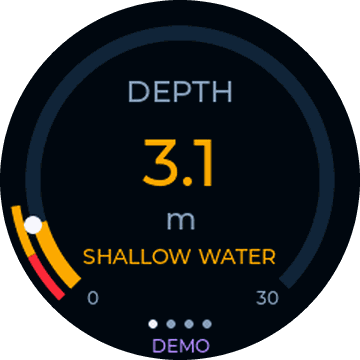 | 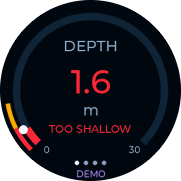 | 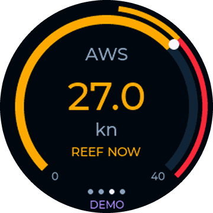 | 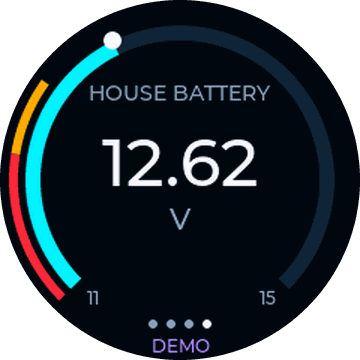 |
|:---:|:---:|:---:|:---:|
| Depth, warning zone | Depth, alarm zone | Wind, warning zone | Battery, normal |

### USB-HID
Listed in the mode ring only while a computer has recognised the knob over USB. The knob shows up as a USB input device only
while this mode is on screen. A long press steps through the profiles, the choice is stored:
- **Chartplotter:** mouse wheel (zoom), a push is a click.
- **Media:** volume, a push is mute.
- **Navigation keys:** arrow keys, a push is Enter.

**(not verified)**

| 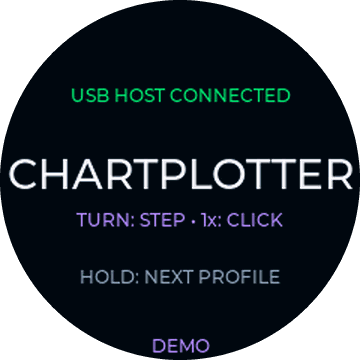 |  | 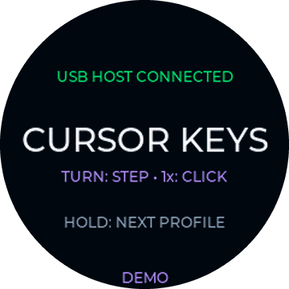 |
|:---:|:---:|:---:|
| Chartplotter | Media | Navigation keys |

## 4. Alarms

An anchor drag or GPS-lost alarm takes over the screen: the backlight goes to full, the five LEDs flash red, the screen says what
happened. A press acknowledges it. The knob then returns to the mode you were in and keeps a slow red pulse and a red ring until the server
clears the alarm. The knob never decides an alarm itself, the server does.

The GPS-lost alarm is raised while the anchor is armed and the position stops updating for 30 seconds or the fix is lost.

| 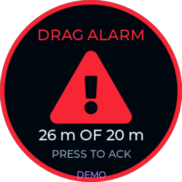 | 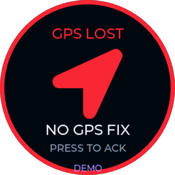 | 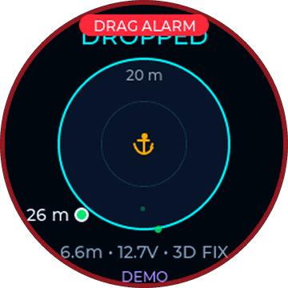 |
|:---:|:---:|:---:|
| Drag alarm | GPS lost | Acknowledged, until the server clears it |

## 5. When data is missing

Every value has its own age. If something the screen depends on stops arriving, the knob says so (`NO HEADING`, `NO AP STATE`,
`LINK LOST`, or `CONNECTING` right after a start) and ignores that mode's controls. It never shows old values as current. The mode ring and the alarm acknowledge still
work. Values the boat does not publish show `---`.

| 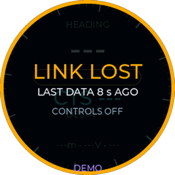 | 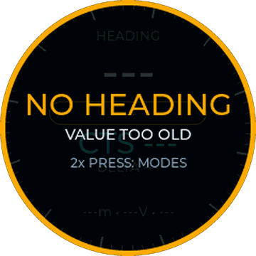 |
|:---:|:---:|
| No link to the server | One value is missing |

## 6. Settings and allow control

- **Settings on the knob.** Double press for the mode ring, choose `SETUP` (the gear). Turn to move through the list, press to
  edit, turn to change, press to store, double press to cancel an edit or to leave. What you store here shows on the settings
  page at once, and the other way round. **(not verified)**

  | Item | What it does |
  |---|---|
  | `BRIGHTNESS` | The normal brightness. Changes while you turn, stored with the press, a double press puts it back |
  | `DIM AFTER`, `DIM LEVEL` | When the screen dims and how far, `NEVER` keeps it bright |
  | `OFF AFTER` | When the screen goes dark, `NEVER` keeps it on |
  | `NIGHT MODE` | Follow the server, or always day or night |
  | `LEDS` | `OFF` keeps every LED dark, the alarm flash included |
  | `HEADING` | True or magnetic |
  | `HID PROFILE` | What the dial does in USB-HID mode |
  | `ALLOW CONTROL` | Whether autopilot, anchor and throttle commands leave the knob |
  | `DEMO MODE` | See section 7 |
  | `THROTTLE STEPS`, `MOTOR LIMITS` | Motor settings, only in the list while the motor mode is on. `MOTOR LIMITS` opens `LIMIT AHEAD`, `LIMIT ASTERN` and `MOTOR DISARM` |
  | `MODES` | Which modes are on the ring |
  | `SETUP ACCESS POINT` | Opens the knob's own setup network |
  | `DEVICE INFO`, `SIGNALK` | Firmware, Wi-Fi and connection, to read only |
  | `RESET SETUP` | Forgets Wi-Fi and the SignalK approval |

  - *Allow control* off to on is a press and then one click to the right within 5 seconds, any press cancels. On to off is one
    press.
  - *Setup access point* opens the knob's own setup network for 10 minutes next to your Wi-Fi, so a phone can reach the settings
    page. Press again to close it.
  - *Reset setup*: hold the button for 5 seconds on its page. The knob forgets the Wi-Fi and its SignalK approval and restarts
    into setup.

- **Settings page.** Open `http://<knob name>.local` in a browser on the same network. The *Rotary knob* section has the autopilot id,
  the heading reference, the default anchor radius, the idle dim time, the dim level, the time until the backlight goes off, and six
  light channels. Changes apply at once, the light channels after a restart. The page is open to anyone on the boat network. If you want a password, set an
  API key in the *HTTP server* section (*Generate* makes one), the page then asks for it. If the knob loses its network for 90
  seconds it opens its setup network again, which you can give a password in the *WiFi* section (*Access point password*).
- **Allow control.** Autopilot, anchor and throttle commands only leave the knob while *Allow control* is on. It is off on a new
  knob and after a factory reset, and stays as you set it across restarts. When it goes on from the settings page, the knob
  shows `CONTROL ON` for three seconds. With it off, the knob shows everything and changes nothing on those three (lights and
  music are not affected). On the bench, the single character `l` on the USB serial port flips it until the next restart without
  storing it.
- **Backup and remote control.** The knob answers on its own small REST API (with the API key as `Authorization: Bearer <key>`
  when you set one):

  ```
  curl http://<knob name>.local/api/v1/config > knob-backup.json         # every setting, passwords left out
  curl -X PUT -H "Content-Type: application/json" --data @knob-backup.json http://<knob name>.local/api/v1/config
  curl -X PUT -H "Content-Type: application/json" --data '{"knob":{"allow_control":true}}' http://<knob name>.local/api/v1/config
  curl -X PUT -H "Content-Type: application/json" --data '{"mode":"anchor"}' http://<knob name>.local/api/v1/knob/mode
  curl http://<knob name>.local/api/v1/knob/status
  ```

  The mode call only switches the screen, it never engages, drops, raises or acknowledges anything.
- **Night and day.** The knob follows the SignalK path `environment.mode`. It starts in day mode until the first value arrives.
- **Dimming.** After 30 seconds without input the backlight drops to 10 %, after 10 minutes it goes off (both can be set, or
  switched off with `NEVER`). It never goes off while the autopilot is engaged or an alarm is active. Any input wakes it: a turn, a press or a touch anywhere on the glass. When the screen was off,
  that first input only wakes it and does nothing else (an alarm acknowledge excepted). When it was dimmed, the input also does
  what it normally does.

| 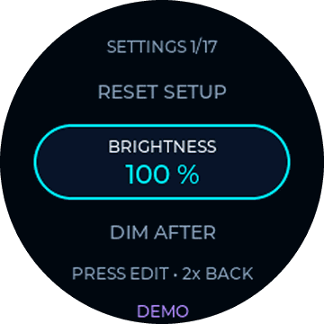 | 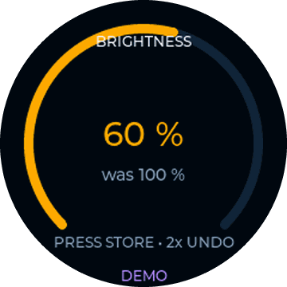 | 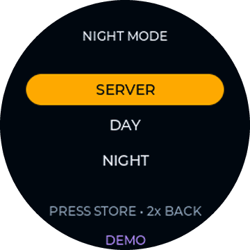 | 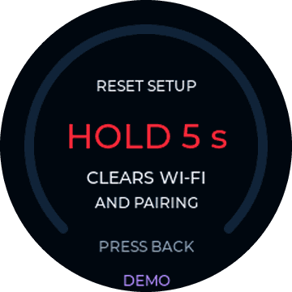 |
|:---:|:---:|:---:|:---:|
| The settings list | Editing a number | Choosing from a menu | *Reset setup* |

| 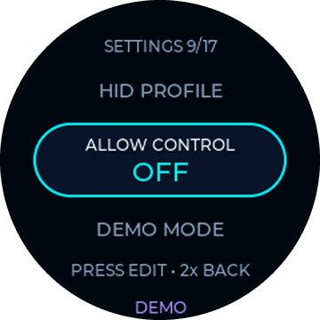 | 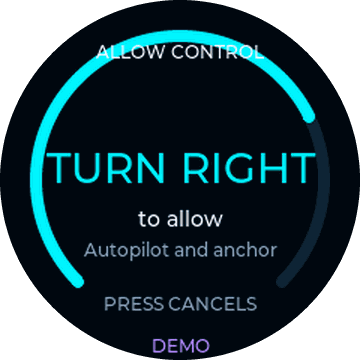 | 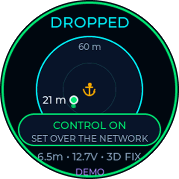 | 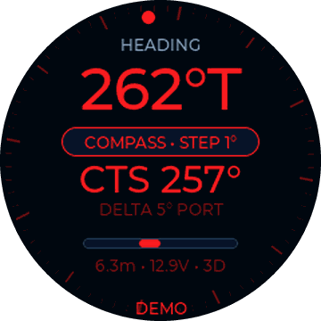 |
|:---:|:---:|:---:|:---:|
| *Allow control* is off | Switching it on: the confirm turn | Switched on from the settings page | Night colours |

## 7. Demo mode

For trying the knob away from the boat. Set *Demo mode* to `ON` in the settings (on the knob or on the settings page). The knob
restarts, shows `DEMO` at the bottom edge and runs on a simulated boat: the heading drifts, the autopilot steers to its target,
the boat swings on the anchor, the lights switch. Set the anchor radius smaller than the swing and the drag alarm goes off.
Nothing is sent to SignalK in demo mode, the knob does not even connect to the server, but Wi-Fi and the settings page stay up,
so you can switch demo off from a phone. It stays on across restarts until you switch it off, a factory reset clears it.

**Automatic demo.** Set *Demo mode* to `AUTO` and the knob shows itself off: after a 3, 2, 1 countdown and its start-up
screen it goes through every mode on its own, engages the autopilot and turns it, drops the anchor, dims a light, turns the
music up, raises and clears a drag alarm, changes the USB profile and ends in the settings. Every turn, press and touch it
makes is drawn on the screen, with a short caption at the top. Touch or turn the knob and it stops and lets you take over;
leave it alone for a minute and it starts again. The tour itself stores nothing. To end it, set *Demo mode* to `OFF` or
`ON`. *Demo mode* `QUIET` runs the same tour without the drawn inputs and captions, for filming the screen. In `AUTO` and
`QUIET` the screen does not dim or go dark. On the settings page the same choices are *Demo mode*, *Automatic demo* and
*Automatic demo without indicators*. **(not verified)**

## 8. Updating the firmware

**(installing over the air works, the rest is not verified)**

**Over the air.** A knob checks this project's update list once a day. In the *OTA* section of the settings page:
- *Channel* `stable` (the default) offers full releases, `beta` also offers pre-releases.
- An update is only shown, not installed, unless *Install automatically* is on.
- An image can also be installed from its web address: paste the link to a release's `-ota.bin`.

The knob restarts into the new firmware and keeps its settings, Wi-Fi and SignalK approval. If the new firmware crashes early or
does not reach the network within 10 minutes, the knob goes back to the previous one by itself. Emptying *Manifest URL* stops the
checks.

**Over USB**, for a first install or a knob that will not start: connect it to a computer and write the release's
`-merged.bin` at offset 0 with esptool (README). The port resets the knob into the bootloader by itself. If the knob is in
the USB-HID mode, leave the mode first or press RESET. A merged image erases the settings: set the knob up again afterwards.

A knob only accepts updates signed with the key it was flashed with. A knob built and flashed from source with your own key
needs one USB install of a release before it takes release updates.

| 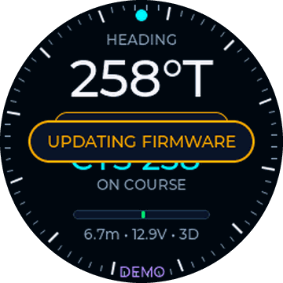 |
|:---:|
| While an update is installed |

## 9. Troubleshooting

| What you see | What it means |
|---|---|
| `JOIN WI-FI` | No Wi-Fi is set up. Join the knob's setup network and enter your Wi-Fi |
| Stuck on `SIGNALK` | Wi-Fi works but no SignalK server was found. Set the server address on the settings page, or check that the server advertises itself on the network |
| `PAIRING` for a long time | The request has not been approved yet in the SignalK admin UI |
| `NO SERVER` | The server refused or cannot be reached. The knob keeps retrying |
| A short `LINK LOST` a few seconds after every start | The setting *Fall back to the SignalK clock* (time section of the settings page) is on. Switch it off, the knob does not need it |
| `CONTROL IS OFF` when you engage or drop | *Allow control* is off, see section 6 |
| The screen is dim | Idle dim, any input wakes it. `DIM AFTER` sets the time or `NEVER` |
| Night colours by day (or the other way round) | `NIGHT MODE` follows the server's `environment.mode`, so check that value on the server. `DAY` or `NIGHT` in the knob's settings overrides it |
| A mode is missing from the ring | It is switched off under *MODES*. `USB` also needs a computer on the cable, `SETUP` is hidden during an alarm |
| `DEMO` at the bottom edge | Demo mode is on: nothing shown is real and nothing is sent. Set `DEMO MODE` to `OFF` |
| The motor refuses to arm | `SET NEUTRAL FIRST`, or allow control is off, or the motor's gear is not reported. The screen says which |
| Phantom touches | The touch controller sometimes reports ghost touches, the knob drops them |
